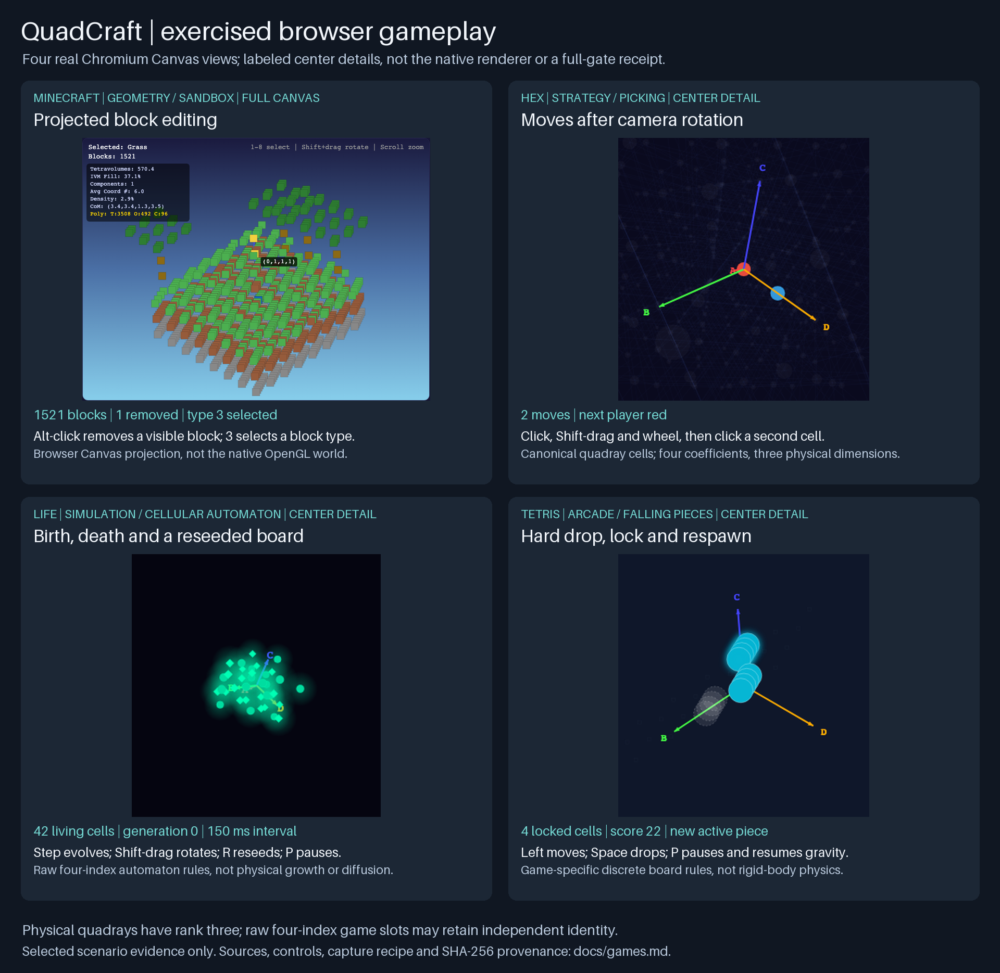

# QuadCraft

Tetrahedral voxel and geometry experiments plus thirty browser games using quadray ideas.

## Status & Verification (agents: start here)

This development checkout contains three distinct runtime families:

| Runtime | What is implemented | Start here |
|---|---|---|
| Native C++17 | GLFW/OpenGL tetrahedral world prototype, generated chunks, colored faces, drone camera and sampled block interaction | [Native setup](docs/development/setup_guide.md) |
| Historical browser/server experiments | Canvas geometry, brushes, CCP ball columns, quaternion camera and experimental Var-tree/JSP synchronization | [JavaScript runtime map](docs/development/javascript_implementation.md) |
| Browser-game portfolio | Thirty game-specific boards/controllers/renderers sharing JavaScript helpers | [Games and contracts](docs/games.md), [catalog](games/GAMES_INDEX.md) |

These are not one production engine. Native ECS/rigid-body physics, plugin/mod loading, imported asset packs and authenticated authoritative multiplayer are not shipped systems. Historical design prose is not a usable SDK. [Architecture](docs/architecture.md) identifies actual ownership and boundaries.

Verification commands are documented in the [testing guide](docs/development/testing_guide.md). No frozen test/assertion total is a current status receipt. [TODO.md](TODO.md) retains dated maintenance history; [CHANGELOG.md](CHANGELOG.md) records changes. This README describes the checkout, not a change to an immutable published release.

## Synergetics suite

QuadCraft is the interactive application member alongside
[QuadMath](https://github.com/docxology/QuadMath) (specification, exact mathematics and lattice algorithms) and
[symergetics](https://github.com/docxology/symergetics) (rational geometry, transformations and research workflows).
The [suite guide](https://github.com/docxology/symergetics/blob/main/docs/synergetics-suite.md)
documents the Y/Z exchange and scale difference between their Cartesian embeddings and an interoperability example. The projects share mathematical contracts, not a production cross-language game runtime.

## Overview

Physical quadrays use four coefficients for a **three-dimensional** point modulo a common additive offset. Raw four-index game slots may intentionally remain independent even when their projections coincide. A game's “4D” name does not imply four independent physical Euclidean axes.

The native prototype explores tetrahedral block geometry and multioctave procedural material selection. Its terrain noise is a deterministic sum of sine waves, not a seeded Perlin/simplex implementation. Its mesher emits tetrahedral faces, not a marching-tetrahedra isosurface.

## Selected gameplay: geometry, strategy, simulation and arcade



These are exercised **browser Canvas** states, not native OpenGL screenshots or four independent physical dimensions. The [gallery guide](docs/games.md#selected-gameplay-gallery) links each game, source, original uncropped capture and recorded state. [Capture and composition commands](games/tests/browser/README.md#selected-gameplay-capture-and-composition) reuse the real Chromium gate's scenarios; the four-view capture is not the full thirty-game gate. [Provenance](docs/figures/gameplay/provenance.json) records browser/time/random controls, crop bounds and PNG hashes.

The [historical quadray-grid image](src/js/experiments/QuadrayGrid_2025-5-26-307pET.png) belongs to the HTML geometry experiments, a separate runtime.

## Building and Running

### Native graphical build

Requirements: C++17 compiler, CMake 3.16+, OpenGL, GLEW and GLFW3. Running needs a graphical session and an OpenGL 3.3 core context. From the repository root:

```sh
cmake -S . -B build -DQUADCRAFT_BUILD_GAME=ON -DCMAKE_BUILD_TYPE=Debug
cmake --build build
./build/bin/QuadCraft
```

Multi-configuration generators require the matching configuration option/path. `./build.sh` wraps the default build and launches; `./build.sh --no-run --test` builds and runs a nonempty native CTest inventory without launching. The wrapper preserves cached CMake options. See [platform/dependency details](docs/development/setup_guide.md).

### Headless core build

Coordinate/world tests do not require OpenGL libraries or a display:

```sh
cmake -S . -B build-core -DQUADCRAFT_BUILD_GAME=OFF -DBUILD_TESTING=ON
cmake --build build-core
(cd build-core && ctest --output-on-failure)
```

`QUADCRAFT_BUILD_GAME` defaults ON; `BUILD_TESTING` is independently controlled. A graphics-free pass does not establish native render/input correctness.

### Browser portfolio

No bundling is needed for ordinary play. Use Python 3.13 explicitly for these launcher/QA examples (the launcher syntax minimum is Python 3.10):

```sh
python3.13 games/run_games.py --list
python3.13 games/run_games.py --game chess doom life
python3.13 games/run_games.py --all --no-browser
python3.13 games/run_games.py --test
python3.13 games/run_games.py --validate
```

The launcher serves static HTTP on base port 8100 plus each catalog offset. Preserve the sibling `games/4d_generic/` directory; copying a game folder alone loses shared dependencies. HTTP is the portable recipe, especially for Doom's ES modules. These servers do not provide multiplayer. The shell convenience wrapper `./games/run.sh chess` chooses its own available interpreter.

### Real Chromium gate

The separate [browser gate](games/tests/browser/README.md) exercises actual game input/state/rendering and records screenshots/logs and real pointer-capture availability. Run from `games/tests/browser/`:

```sh
npm ci --ignore-scripts --no-audit --no-fund
npx --no-install playwright install --with-deps chromium
PYTHON=python3.13 npm test
```

Ordinary `run_games.py --test` runs Node/Python logic suites, not this Chromium package. Structural validation, logic tests and real-browser checks have different coverage.

## Controls

The following refer to native [`Input.h`](src/game/Input.h), not the historical browser experiment or every portfolio game:

- Arrow keys: drone-like forward/back/left/right; Page Up/Down: vertical motion, with or without mouse capture.
- WASD and Space: captured-mouse movement/up. Shift/Control modify movement speed; do not assume Shift is a working down binding (Page Down is).
- Mouse look requires capture; wheel adjusts camera zoom.
- Left click captures the cursor when free; when captured, left/right block actions remove/place stone if the sampled ray finds a stored block.
- Tab toggles capture. Escape releases capture when captured and requests exit when free.
- F1 toggles wireframe; F2 toggles the coordinate overlay; F4 toggles diagnostic distance reporting.

Block picking uses sampled world-key queries rather than exact face intersection; visible-face selection is not guaranteed. Native movement has no terrain collision/gravity solver. For browser controls, use the selected game's own page and [portfolio documentation](docs/games.md).

## Architecture

```text
src/core/       native coordinates, world/chunks/materials, camera
src/game/       native lifecycle, GLFW input and embedded shader sources
src/render/     native face meshing, GL meshes and shader utilities
src/browser/   geometry experiments, including newer Var-tree page
src/js/        historical HTML and modular JavaScript experiments
src/server/    experimental Tomcat/JSP state merge
games/         thirty browser games, shared JS and Python launcher/QA
docs/          implementation guides, mathematics and explicit design context
```

The native world uses Cartesian integer chunk keys, local quadray element keys and world-space mesh vertices. [Chunk lifecycle](docs/development/chunk_system.md) explains creation/generation, dirty flags and numeric limits. The browser portfolio has its own board identity and time ownership.

## Implementation Details

Use the [actual C++ API reference](docs/development/api_reference.md) instead of copying historical class diagrams. [Portfolio contracts](docs/games.md) cover raw versus physical cells, twelve-contact versus raw eight-neighbor graphs, fixed update seconds, seeded streams and conservative transport. Conservative graph mixing is not symmetric-normalized heat.

The [documentation hub](docs/README.md) and [development index](docs/development/README.md) route to focused topics. [Source customization](docs/development/modding_guide.md) describes real extension points without inventing an installed mod SDK. [JSP synchronization](docs/development/multiplayer_system.md) describes its limited experiment, not a production service.

## License

Apache 2.0; see [LICENSE](LICENSE).

## Acknowledgments

Inspired by Minecraft, tetrahedral-mesh game research, and quadray/Synergetics work associated with R. Buckminster Fuller and Kirby Urner. Mathematical inspiration does not imply validation of every experimental geometry or gameplay claim.
