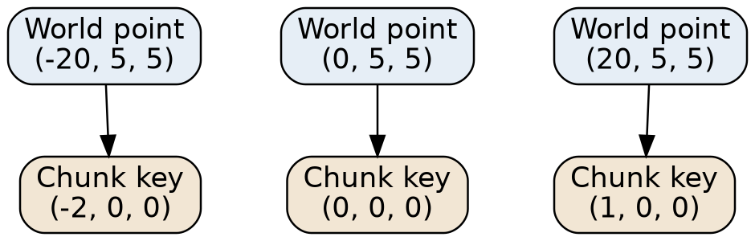

# Results

The three sampled positions fall in chunks with negative, zero, and
positive horizontal keys. The negative position falls two chunks below
zero, consistent with floor division and the documented half-open
bounds. Figure 1 shows the observed sample-to-key mapping.

The probe confirmed that the common coefficient offset preserves all
sample coordinates within tolerance. A dirt block written using the
negative position can be read through its shifted representative.
An adjacent position reads as air.
