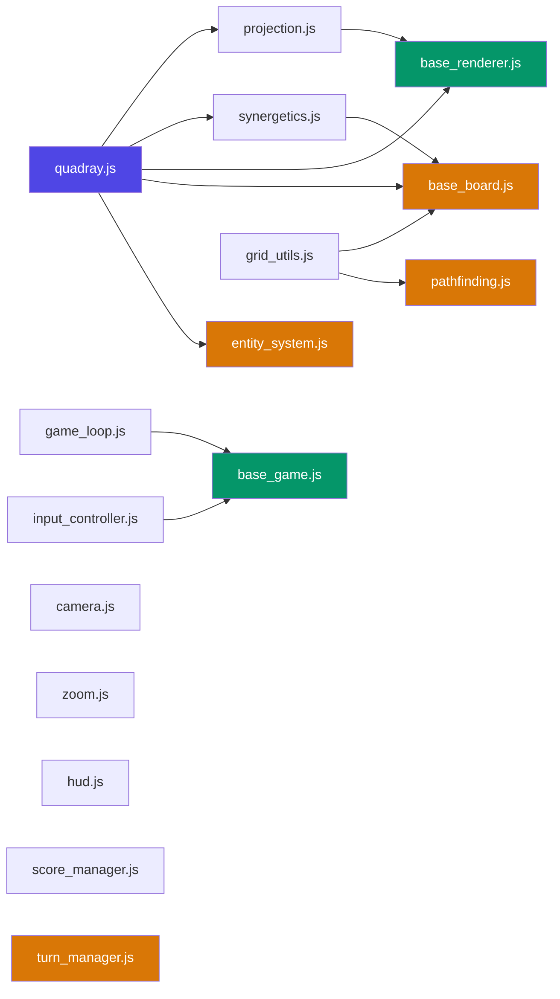

# Shared Modules Reference — `4d_generic/`

> **Note on 4D Geometry & Nomenclature**: "4D" in QuadCraft strictly means **Synergetics** geometry (Quadray tetrahedral coordinates on an IVM; 12 neighbors = permutations of `(0, 1, 1, 2)`). Canonical statement: [GAMES_INDEX.md](../GAMES_INDEX.md#note-on-4d-geometry--nomenclature).


> Canonical documentation for all 17 shared JavaScript modules that form the foundation layer of every QuadCraft game.

---

## Module Index

| # | Module | Category | Dependencies | Description |
|---|--------|----------|--------------|-------------|
| 1 | `quadray.js` | math | — | Quadray 4D coordinate class with arithmetic, normalization, conversions |
| 2 | `camera.js` | rendering | — | `CameraController` — shift-drag rotation for 3D/4D scenes |
| 3 | `projection.js` | rendering | `quadray.js` | `projectQuadray()` → screen-space; `drawQuadrayAxes()` |
| 4 | `zoom.js` | rendering | — | `setupZoom()` — mouse wheel zoom with min/max clamping |
| 5 | `synergetics.js` | math | `quadray.js` | IVM constants, volume ratios (Tetra/Octa/Icosa), Jitterbug, D/R conversion |
| 6 | `input_controller.js` | input | — | `InputController` — event-driven keyboard bindings + polled `isDown()` state |
| 7 | `game_loop.js` | engine | — | `GameLoop` — fixed-timestep rAF loop with pause/stop/start lifecycle |
| 8 | `hud.js` | ui | — | `HUD` — color-coded state manager for status overlays |
| 9 | `score_manager.js` | engine | — | `ScoreManager` — score/level/lives tracker with localStorage persistence |
| 10 | `grid_utils.js` | math | — | `GridUtils` — IVM grid generation, neighbors, bounds, distance, depth sort |
| 11 | `base_renderer.js` | rendering | `quadray.js`, `projection.js` | `BaseRenderer` — canvas setup, Quadray projection, axis drawing, primitives |
| 12 | `base_game.js` | engine | `game_loop.js`, `input_controller.js` | `BaseGame` — lifecycle controller with auto-setup for loop, input, camera |
| 13 | `base_board.js` | board | `quadray.js`, `grid_utils.js`, `synergetics.js` | `BaseBoard` — common grid ops, distances, integrity, metadata |
| 14 | `entity_system.js` | engine | `quadray.js` | `QuadrayEntity` + `EntityManager` — position/velocity, collision, wrapping |
| 15 | `turn_manager.js` | engine | — | `TurnManager` — player rotation, move history, undo/redo |
| 16 | `pathfinding.js` | board | `grid_utils.js` | `QuadrayPathfinder` — BFS, A*, flood fill, line-of-sight |
| 17 | `hud-style.css` | ui | — | Shared CSS for HUD panels, overlays, and status bars |

---

## Load Order

Modules **must** be loaded in dependency-safe order in `index.html`. The canonical order:

```html
<!-- 1. Core Math (no dependencies) -->
<script src="../4d_generic/quadray.js"></script>

<!-- 2. Rendering (some depend on quadray.js) -->
<script src="../4d_generic/camera.js"></script>
<script src="../4d_generic/projection.js"></script>
<script src="../4d_generic/zoom.js"></script>

<!-- 3. Math Extensions -->
<script src="../4d_generic/synergetics.js"></script>
<script src="../4d_generic/grid_utils.js"></script>

<!-- 4. Engine (no math dependencies) -->
<script src="../4d_generic/game_loop.js"></script>
<script src="../4d_generic/input_controller.js"></script>
<script src="../4d_generic/score_manager.js"></script>

<!-- 5. UI -->
<script src="../4d_generic/hud.js"></script>

<!-- 6. Base Classes (depend on above) -->
<script src="../4d_generic/base_renderer.js"></script>
<script src="../4d_generic/base_game.js"></script>
<script src="../4d_generic/base_board.js"></script>

<!-- 7. Optional: Game-Pattern Modules -->
<!-- <script src="../4d_generic/entity_system.js"></script> -->
<!-- <script src="../4d_generic/turn_manager.js"></script> -->
<!-- <script src="../4d_generic/pathfinding.js"></script> -->
```

> **Programmatic access:** `ModuleRegistry().load_order()` in `src/shared/` performs topological sort automatically.

---

## Dependency Graph



---

## Module Details

### `quadray.js` — Quadray Coordinate Class

**Category:** math · **Dependencies:** none

The single source of truth for Quadray 4D coordinates `(a, b, c, d)`.

| Method/Property | Description |
|----------------|-------------|
| `new Quadray(a, b, c, d)` | Construct from 4 components |
| `.normalized()` | Zero-minimum normalization |
| `.toXYZ()` | Convert to Cartesian `{x, y, z}` |
| `Quadray.fromXYZ(x, y, z)` | Static: Cartesian → Quadray |
| `.add(q)` / `.sub(q)` / `.scale(s)` | Arithmetic operations |
| `.length()` | Vector magnitude `√((a²+b²+c²+d²)/2)` |
| `.distanceTo(q)` | Native Quadray 4D distance |
| `.equals(q, ε)` | Tolerance-based equality |
| `.toKey()` | Integer-rounded string key for Maps/Sets |

---

### `camera.js` — CameraController

**Category:** rendering · **Dependencies:** none

Provides shift-drag rotation for 3D/4D scene navigation.

| Method/Property | Description |
|----------------|-------------|
| `new CameraController(canvas)` | Attach to canvas element |
| `.rotX`, `.rotY` | Current rotation angles |
| `.getRotation()` | Get `{rotX, rotY}` state |

---

### `projection.js` — Quadray Projection

**Category:** rendering · **Dependencies:** `quadray.js`

| Method/Property | Description |
|----------------|-------------|
| `projectQuadray(a, b, c, d, camera, zoom)` | Quadray → `{x, y, scale}` screen coords |
| `drawQuadrayAxes(ctx, camera, zoom)` | Draw labeled ABCD axes on canvas |

---

### `zoom.js` — Mouse Wheel Zoom

**Category:** rendering · **Dependencies:** none

| Method/Property | Description |
|----------------|-------------|
| `setupZoom(canvas, options)` | Attach wheel listener; returns `{getZoom()}` |

---

### `synergetics.js` — IVM Constants & Verification

**Category:** math · **Dependencies:** `quadray.js`

| Constant / Method | Description |
|-------------------|-------------|
| `SYNERGETICS.TETRA_VOL` | Tetrahedron volume = 1 |
| `SYNERGETICS.OCTA_VOL` | Octahedron volume = 4 |
| `SYNERGETICS.ICOSA_VOL` | Icosahedron volume ≈ 18.51 |
| `SYNERGETICS.PHI` | Golden ratio (1+√5)/2 |
| `SYNERGETICS.S3` | √(9/8) ≈ 1.0607 |
| `verifyGeometricIdentities()` | 8-check Synergetics verification suite |

---

### `grid_utils.js` — GridUtils

**Category:** math · **Dependencies:** none

| Method | Description |
|--------|-------------|
| `GridUtils.generateGrid(size)` | All raw four-index cells in a `size⁴` box |
| `GridUtils.generateCanonicalGrid(size)` | Distinct minimum-zero representatives |
| `GridUtils.neighbors(a,b,c,d)` | Twelve canonical physical IVM neighbor moves |
| `GridUtils.boundedNeighbors(a,b,c,d,size)` | Those canonical neighbors inside the component bounds |
| `GridUtils.inBounds(a,b,c,d,size)` | Raw component bounds check |
| `GridUtils.manhattan(p1,p2)` / `.euclidean(p1,p2)` | Raw four-component distances, not quotient spatial metrics |
| `GridUtils.depthSort(cells, projectFn)` | Painter's algorithm sort |
| `GridUtils.createSeededRng(seed)` | Independent deterministic 32-bit simulation stream |
| `GridUtils.shuffle(arr, rngFn)` | In-place Fisher–Yates shuffle; optional injected RNG |

---

### `game_loop.js` — GameLoop

**Category:** engine · **Dependencies:** none

| Method | Description |
|--------|-------------|
| `new GameLoop({update, render, tickRate})` | Fixed updates; `tickRate` is milliseconds per tick |
| `.start()` / `.stop()` / `.togglePause()` | Lifecycle control |
| `.paused` / `.animationId` | Current pause and scheduled-frame state |

`update(dtSeconds)` receives the fixed duration in **seconds**; render receives
the accumulator fraction. A frame contributes at most 250 milliseconds.
Continuous games integrate the supplied duration; discrete boards may ignore it.
`BaseGame` and generated scaffold controllers forward that same duration.
Asteroids owns no second wall clock; Doom uses its equivalent fixed-60-Hz
controller and settles elapsed time before applying live input.

### `graph_field.js` — ConservativeGraphField

**Category:** simulation · **Dependencies:** none

| API | Contract |
|---|---|
| `new ConservativeGraphField(size, edges)` | Fixed undirected uniform-site graph; duplicate/reversed edges collapse and self-loops are ignored |
| `.step(values, alpha, out=null, active=null)` | Synchronous `I - alpha*L/dMax` mixing, dimensionless `alpha` in `[0,1]`; optional non-aliasing output and active-site mask |
| `.maxDegree` | Degree bound of the full constructed graph, retained when masking edges |

For finite concentrations within the numeric range, symmetric edge flux
preserves closed-graph mass and range up to floating roundoff. Masks disable
incident edges without deleting stored values. The kernel adds no sources,
evaporation or saturation. SimAnt separately supplies eight reversible raw
neighbors, terrain permeability, ten-tick mixing and five-tick evaporation.
Its raw labels must not be canonicalized through `GridUtils.neighbors`.
The [suite example](https://github.com/docxology/symergetics/blob/main/examples/suite_interoperability.py)
compares this generic operator with QuadMath on an explicitly exchanged FCC graph.

---

### `input_controller.js` — InputController

**Category:** input · **Dependencies:** none

| Method | Description |
|--------|-------------|
| `new InputController()` | Create bindings and held-key state; does not attach yet |
| `.attach()` / `.detach()` | Attach/remove the document keyboard listeners |
| `.bind(keys, callback, actionName=null)` | Event-driven key or key-array callback |
| `.isDown(key)` | Polled held-key state |

---

### `score_manager.js` — ScoreManager

**Category:** engine · **Dependencies:** none

| Method | Description |
|--------|-------------|
| `new ScoreManager(gameKey)` | Create with localStorage key prefix |
| `.addScore(points)` / `.getScore()` | Score management |
| `.setLevel(n)` / `.getLevel()` | Level tracking |
| `.loseLife()` / `.getLives()` | Lives tracking |
| `.isGameOver()` | Check lives ≤ 0 |
| `.getHighScore()` / `.saveHighScore()` | Persistent high score |
| `.reset()` | Reset session |

---

### `hud.js` — HUD Manager

**Category:** ui · **Dependencies:** none

| Method | Description |
|--------|-------------|
| `new HUD(elementId)` | Attach to DOM element |
| `.update(state)` | Update display with game state object |
| `.setStatus(text, color)` | Set status line with color coding |

---

### `base_renderer.js` — BaseRenderer

**Category:** rendering · **Dependencies:** `quadray.js`, `projection.js`

| Method | Description |
|--------|-------------|
| `new BaseRenderer(canvas)` | Set up 2D context with auto-resize |
| `.clear()` | Clear canvas |
| `.drawAxes(camera, zoom)` | Draw Quadray ABCD axes |
| `.projectQuadray(a,b,c,d,camera,zoom)` | Delegate to `projectQuadray()` |
| `.drawCell(x, y, size, color)` | Draw a single cell shape |
| `.drawLine(x1,y1,x2,y2,color)` | Draw a line segment |

---

### `base_game.js` — BaseGame

**Category:** engine · **Dependencies:** `game_loop.js`, `input_controller.js`

| Method | Description |
|--------|-------------|
| `new BaseGame(canvas, hudElement, board, renderer, opts)` | Compose actual board/renderer with loop, input, HUD and optional camera/zoom |
| `.init()` | Attach input and start the loop |
| `.update(dtSeconds)` | Override game logic per fixed tick |
| `._setupGameInput()` / `._getHUDState()` | Override game bindings and HUD state |
| `.togglePause()` / `.reset()` | Pause or reset board and loop |
| `.loop` | Underlying `GameLoop`; rendering calls `renderer.render()` |
| `.input` | Underlying `InputController` |

---

### `hud-style.css` — Shared HUD Styles

Provides consistent styling for all game HUD overlays, panels, and status bars.

---

### `base_board.js` — BaseBoard

**Category:** board · **Dependencies:** `quadray.js`, `grid_utils.js`, `synergetics.js`

Common board logic extracted from 20 game board files. Provides grid operations, geometric verification, distance calculations, and base metadata.

| Method | Description |
|--------|-------------|
| `new BaseBoard(size, options)` | Create grid with size and game-specific options |
| `.getCell(q)` | Get cell value by Quadray position |
| `.setCell(q, value)` | Set cell value by Quadray position |
| `.key(q)` | Convert Quadray to string key via `GridUtils.key()` |
| `.parseKey(key)` | Parse string key back to `{a,b,c,d}` |
| `.getNeighbors(q)` | In-bounds IVM neighbors via `GridUtils.boundedNeighbors()` |
| `.manhattanDistance(q1, q2)` | Manhattan distance via `GridUtils.manhattan()` |
| `.euclideanDistance(q1, q2)` | Raw 4-component distance via `GridUtils.euclidean()` |
| `.quadrayDistance(q1, q2)` | IVM distance via `Quadray.distance()` |
| `.angleBetween(from, to1, to2)` | Angle via `angleBetweenQuadrays()` |
| `._verifyIntegrity()` | Geometric round-trip verification on corners |
| `.getMetadata()` | Base game state (size, cellCount, gameOver, score) |
| `BaseBoard.DIRECTIONS` | Static: 8 IVM face-touching direction vectors |

---

### `entity_system.js` — QuadrayEntity + EntityManager

**Category:** engine · **Dependencies:** `quadray.js`

Entity management for real-time games (Asteroids, Frogger, Pong, etc.). Handles position, velocity, collision, and world wrapping.

| Class / Method | Description |
|----------------|-------------|
| `new QuadrayEntity(options)` | Create entity with position, velocity, radius, type |
| `.update(dt)` | Advance position by velocity × dt |
| `.distanceTo(other)` | Distance between two entities |
| `.collidesWith(other)` | Radius-based collision detection |
| `.wrapToGrid(size)` | Wrap entity position to grid bounds |
| `new EntityManager()` | Create empty entity manager |
| `.add(entity)` | Register an entity |
| `.remove(entity)` | Remove an entity |
| `.getByType(type)` | Filter entities by type string |
| `.updateAll(dt)` | Batch-update all entities |
| `.detectCollisions(typeA, typeB)` | Find all colliding pairs between two types |
| `.wrapAll(size)` | Wrap all entity positions |

---

### `turn_manager.js` — TurnManager

**Category:** engine · **Dependencies:** none

Turn management for turn-based games (Chess, Checkers, Reversi, etc.). Handles player rotation, move history, and undo/redo.

| Method | Description |
|--------|-------------|
| `new TurnManager(players, options)` | Create with player list + optional config |
| `.getCurrentPlayer()` | Get current player |
| `.nextTurn()` | Advance to next player |
| `.recordMove(move)` | Push move onto history stack |
| `.undo()` | Pop last move and return it |
| `.redo()` | Reapply last undone move |
| `.getMoveHistory()` | Full move history array |
| `.getTurnNumber()` | Current turn count |
| `.reset()` | Reset turn state |
| `.getState()` | Serializable snapshot for save/load |
| `.loadState(state)` | Restore from snapshot |

---

### `pathfinding.js` — QuadrayPathfinder

**Category:** board · **Dependencies:** `grid_utils.js`

Pathfinding algorithms for IVM grids. Used by games with AI movement, route planning, or range queries.

| Method | Description |
|--------|-------------|
| `new QuadrayPathfinder(options)` | Create pathfinder with size, isBlocked callback |
| `.bfs(start, goal)` | Breadth-first search → shortest path |
| `.aStar(start, goal, heuristic)` | A* search with custom heuristic |
| `.floodFill(start, maxDist)` | All reachable cells within maxDist |
| `.lineOfSight(from, to)` | Check unobstructed line between positions |
| `.getRange(center, radius)` | All cells within radius (Manhattan) |

---

## Categories Summary

| Category | Modules | Purpose |
|----------|---------|---------|
| **math** | `quadray.js`, `synergetics.js`, `grid_utils.js` | 4D coordinate math, constants, grid operations |
| **rendering** | `camera.js`, `projection.js`, `zoom.js`, `base_renderer.js` | 3D/4D visualization pipeline |
| **engine** | `game_loop.js`, `score_manager.js`, `base_game.js`, `entity_system.js`, `turn_manager.js` | Game lifecycle, scoring, entity management, turn logic |
| **board** | `base_board.js`, `pathfinding.js` | Grid board logic, pathfinding algorithms |
| **input** | `input_controller.js` | Keyboard/mouse event handling |
| **ui** | `hud.js`, `hud-style.css` | Heads-up display overlays |

---

*See also: [architecture.md](architecture.md) · [space_math_reference.md](space_math_reference.md) · [game_template.md](game_template.md)*
